# desk-ink — 桌面墨水屏信息站

一块放在课桌上的 4.2 寸墨水屏，用来显示**课表 / 待办 / 每日一言 / 新闻 / 插画**，基于 ESP32-C3。

**设计主线只有一个：省电。** 墨水屏断电保留画面 + 主控深度休眠 + RTC 定时唤醒，
平均功耗目标约 **18 µA**，1000 mAh 电池续航约 **32 天**。

---

## ⚠️ 开发状态：**尚未在实机验证**

> **这一条请先读。** 截至 2026-09-23：

- ✅ **代码能编译**（ESP-IDF v6.0.1 / ESP32-C3，app 分区余约 72%）
- ✅ **UI 已在 QEMU 里逐状态验证**，17 张实图见下面的“界面预览”
- ✅ **PC 端工具能编译**（.NET 8 / WinUI 3，0 警告 0 错误）
- ❌ **没有点亮过真实的墨水屏**
- ❌ **没有连接过真实硬件**（串口 / 蓝牙 / ADC / RTC 全都没跑过）
- 🟡 **电路图已基本画完**（立创 EDA），开关部分目前仍是拨轮，待改为五向开关
- ❌ **PCB 尚未布线**

也就是说：**这是一个"写完了但没上过电"的项目。** 里面的时序、电压阈值、
刷屏参数都还是按规格书推算的，**首次实机调试大概率需要调整**。

配合的实机流程在 [`点灯清单`](docs/desk-eink-info/点灯清单.md) 里（分段上电，便于定位问题）。

---

## 最新进展

**[2026-09-23] 电路图基本画完**

原理图大部分已完成（立创 EDA）。开关部分目前仍是**拨轮**，待改成**五向开关**；PCB 尚未布线。

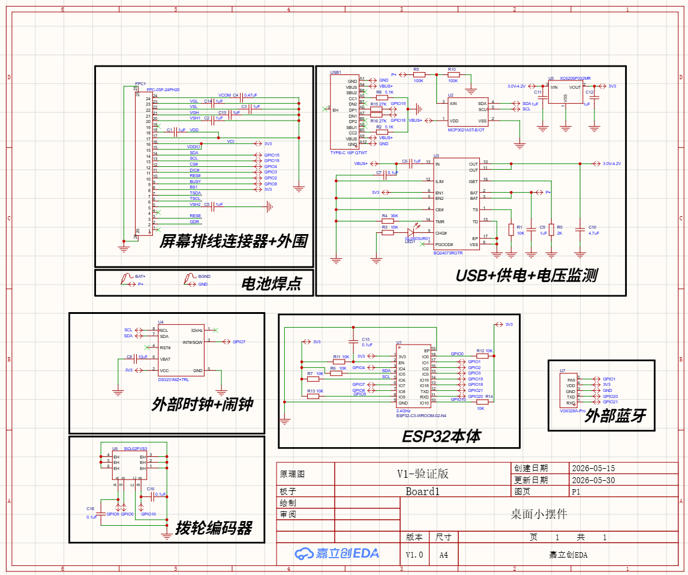

---

## 界面预览

下面这些是**固件真代码在 QEMU 里渲染出来的**（不是设计稿，也不是复刻）：

| 空闲·每日一言 | 空闲·新闻 | 菜单 | 待办 |
|---|---|---|---|
| 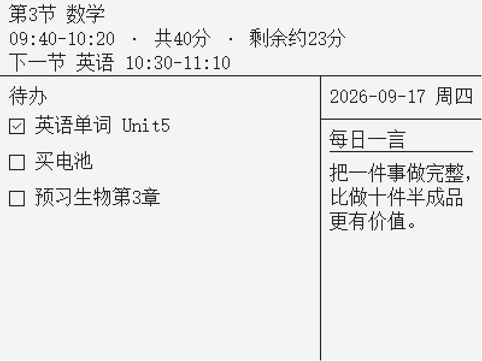 | 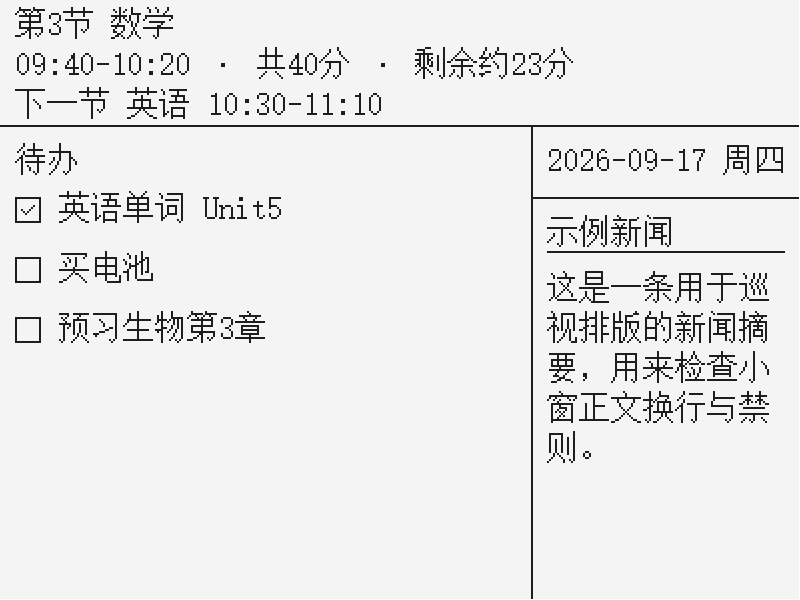 | 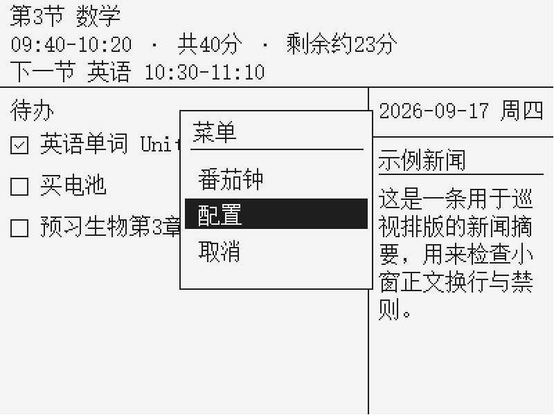 | 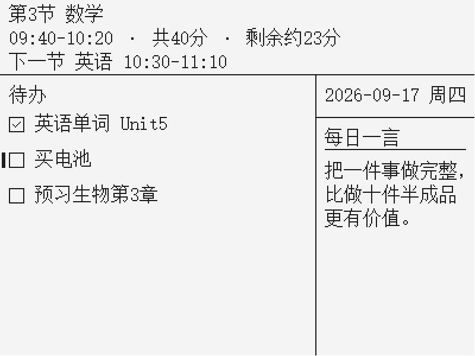 |
| 配置页·刷新档位 | 配置页·信息条 | 待办编辑 | 番茄钟 |
|  |  | 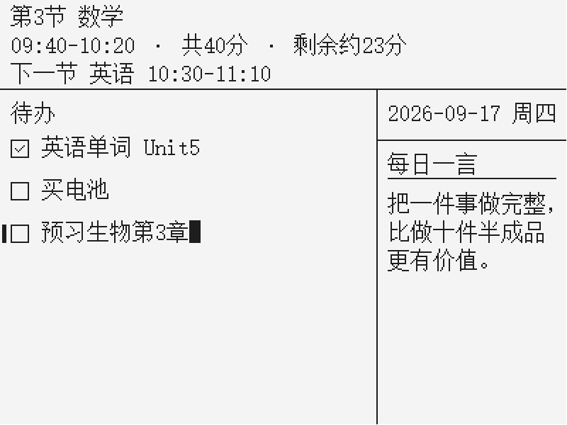 | 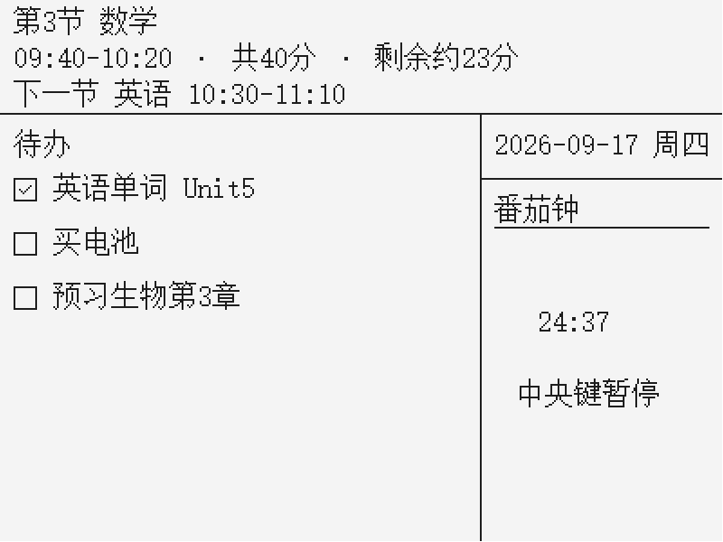 |
| 全屏插画·实心条 | 全屏插画·反色条 | 全屏插画·自适应 | 插画小窗 |
| 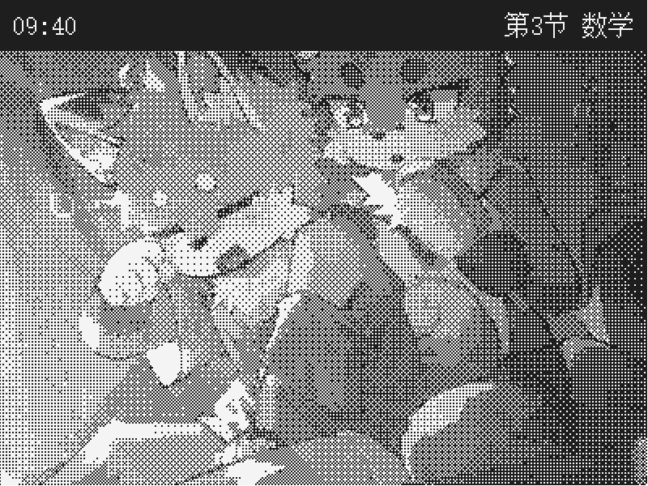 | 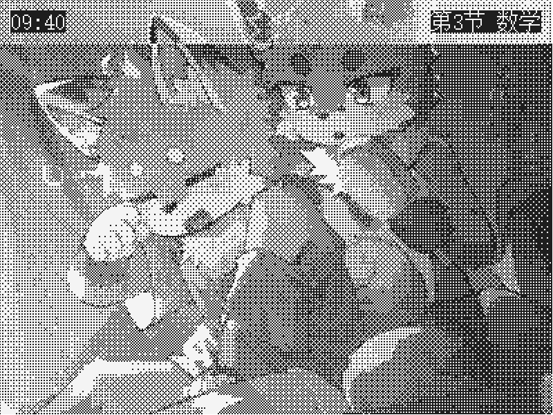 | 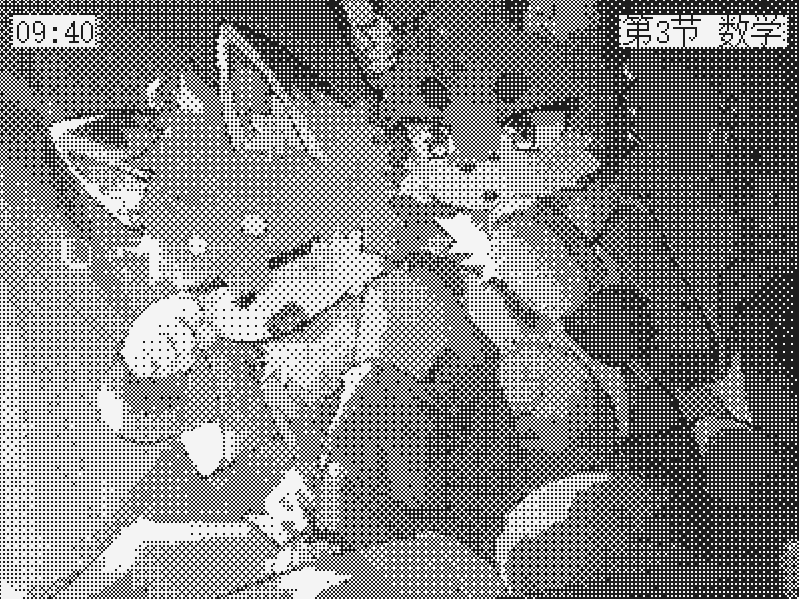 | 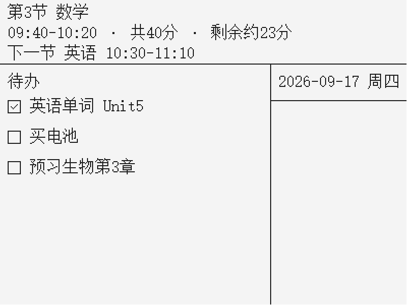 |

全部 **17 个状态**在 `docs/desk-eink-info/qemu-tour/`（含配置页六项、插画小窗、
全屏插画 × 三种信息条模式）。

> 📌 最后一行那四帧用的是**真实照片素材**（灰度 → 4×4 有序抖动 → 1-bit）。
> 信息条三种模式的差别一眼可见：顶部 64px 条带的墨点占比分别是 **96% / 39% / 60%**。实心是纯黑条，反色和自适应则取决于底下那张图。

---

## PC 端工具

墨水屏那半边是设备，这半边是电脑上的配套程序（`pc-tool/`）。选**原生 WinUI 3 而不是 web**，是因为它要做三件浏览器做不了的事：读 ClassIsland 的 .NET IPC、直接占串口、常驻托盘。

| 页面 | 干什么 |
|---|---|
| **管理** | 运行状态（ClassIsland IPC、串口）+ 当前课表 |
| **插画** | 导入图片，裁剪，灰度，有序抖动成 1-bit，预览，分片上传 |
| **一言** | 四种来源：hitokoto 公益源 / 自定义网址 / 本地文件 / 手动。每天一条，跨天自动换，联网源不可用时用内置文案兜底 |
| **待办** | 列表编辑（≤8 条，每条 ≤14 汉字），分片推送；设备上勾选后会回传，这边列表跟着变 |
| **设置** | 串口选择与自动发现、推送策略（事件触发 / 定时补推 / 补推间隔） |

实际的界面（点开可看大图）：

| 管理 | 插画 |
|---|---|
| 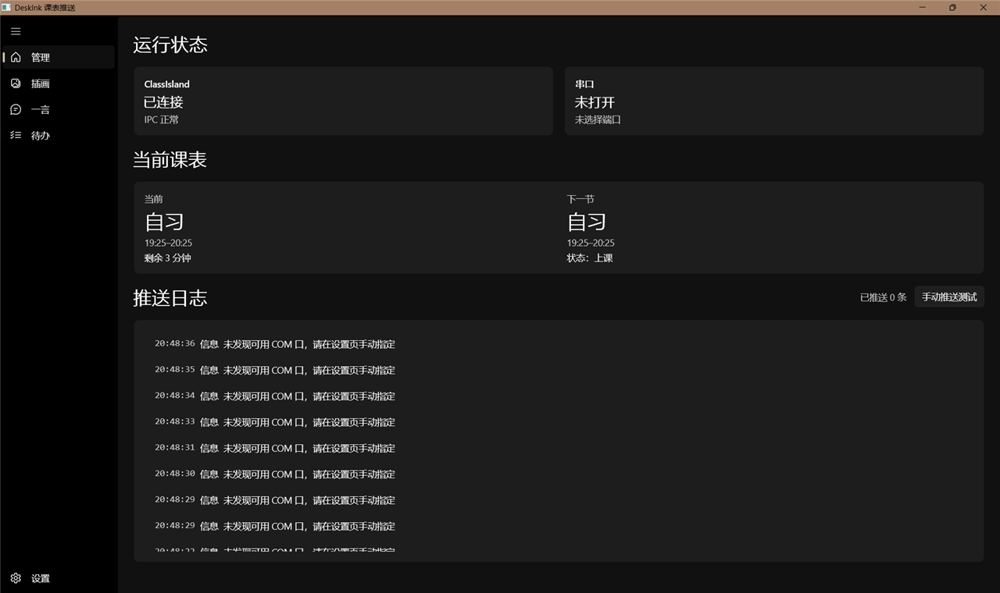 | 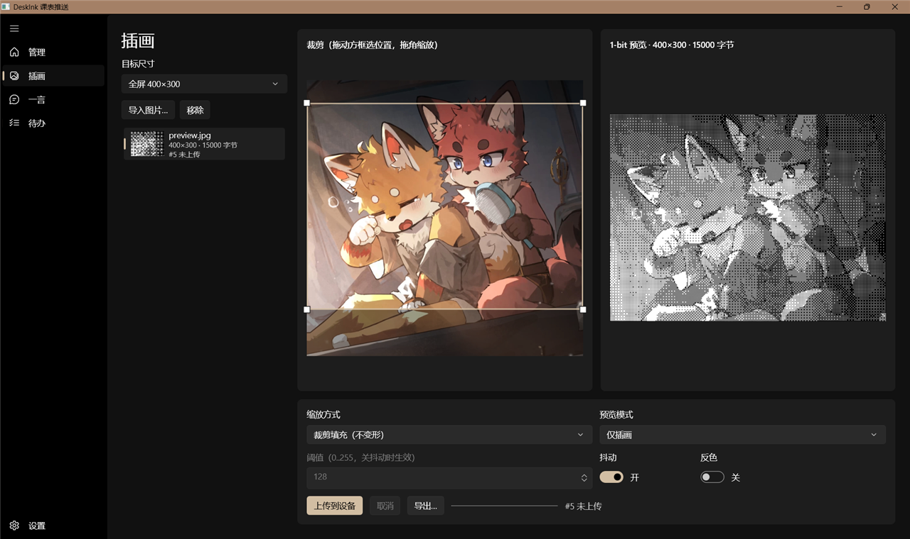 |
| 一言 | 待办 |
| 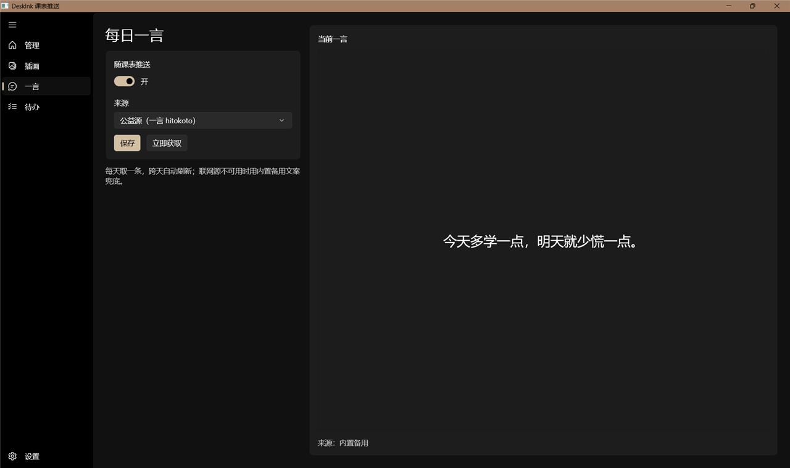 | 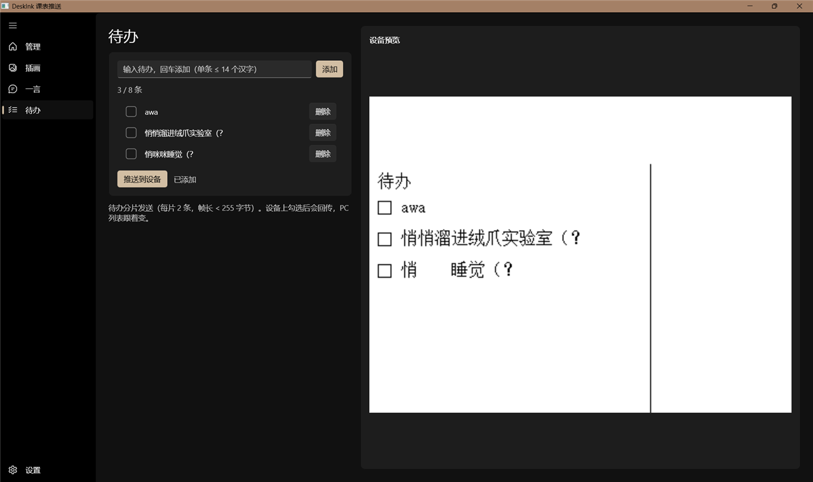 |
| 设置 | |
| 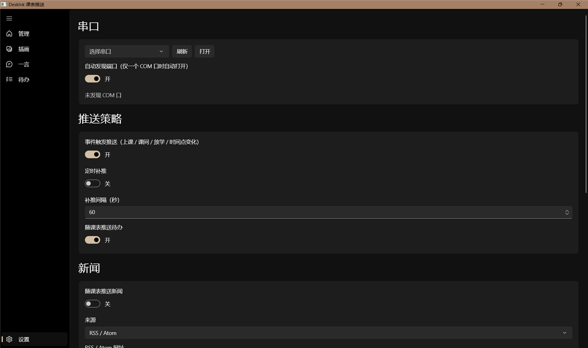 | |

**跑起来**：`pc-tool/` 下 `dotnet build`。串口枚举和字库读取放在后台线程，窗口不会假死；支持开机自启（写 `HKCU\...\Run`）和最小化到托盘。

> ⚠️ **串口实传还没测过**，因为没有硬件。消息构造、分片、CRC 都实现并自检过帧长（最大 132 字节，限值 255），但没在真实蓝牙链路上跑通。

---

## ⭐ 求个 Star

如果这个项目对你有用或者有点意思，**欢迎点个 Star**。

说实话，我用它来看有多少人在跟这个进度，也是我继续把它做完的动力。

---

## 这个项目其实是个实验

技术目标（做一块省电的桌面墨水屏）只是外壳。真正想验证的是：

> **在嵌入式这种“软硬交界、规格书满天飞”的场景里，现在的 AI 到底能干多少？能替代掉多少人工？**

所以整个项目里，我刻意**只做两件事：选型、关键决策**。其余调研、方案、文档、编码、
验证全交给 AI，**不插手**，我就想看它能自己走多远，会在哪里卡住。

| 角色 | 工具 | 地址 |
|---|---|---|
| 调研 / 方案 / 文档 / 调度 | **Hanagent** | https://github.com/liliMozi/openhanako |
| 代码编写 | **OpenCode** | https://opencode.ai |
| 模型 | **DS4.1 Flash** | — |
| IDE | **VSCode** | — |

→ **详细心得在[`docs/项目心得.md`](docs/项目心得.md)**

---

## 当前状态

| 部分 | 状态 |
|---|---|
| 结构 / 引脚分配 | 已完成（三代定稿） |
| 原理图 | 基本完成；开关部分仍是拨轮，待改五向开关 |
| PCB 布线 | **未开始** |
| 方案文档 | 已完成（`docs/desk-eink-info/`） |
| 固件 | `ui` / `font` / `link` / `store` / `eink`(整屏) / `rtc` / `power` / `input` / `app` 状态机已实现；**局部刷新与深睡编排未做** |
| 字库 | 已生成（宋体 16×16，含 GB2312 1~3 区中文标点，约 4037 字 / 137 KB） |
| PC 端工具 | 已实现（插画上传、一言、新闻、待办、设备配置只读同步、合成预览）；**串口实传未测** |
| 硬件实物 | 转接板已到货；**墨水屏尚未点亮**，其他模块尚未购买 |

---

## 目录速查

```
desk-ink/
├── bord/            立创 EDA 工程（原理图 / PCB）
├── docs/
│   ├── README.md              文档索引（从这进）
│   ├── desk-eink-info/        全部方案文档（核心）
│   ├── 结构图/                结构总图；"各部分引脚分配"为历史存档
│   ├── 电路图/                电路图进展截图
│   └── refs/                  ClassIsland 2.1.0.1 接口 XML
├── pc-tool/         PC 端工具（.NET 8 + WinUI 3）
├── shell/           FreeCAD 外壳模型（仅一代）
├── software/        ESP-IDF 固件工程
│   ├── components/    eink / font / input / link / power / rtc / store / ui / app
│   ├── font/          点阵字库 + 生成工具
│   └── main/          入口
├── tools/           离线预览工具（1-bit 渲染的参考实现）
├── LICENSE          GPL-3.0
└── README.md
```

---

## 开发环境

| 项 | 值 |
|---|---|
| 框架 | ESP-IDF **v6.0.1** |
| 目标芯片 | ESP32-C3（RISC-V） |
| Flash | 4 MB |
| 固件工程 | `software/` |
| PC 端工具 | .NET 8 + WinUI 3，`pc-tool/` |

**构建固件**

- VS Code 里 `Ctrl+Shift+B`（已配好 `software/.vscode/tasks.json`）
- 或命令行：source IDF 环境后 `idf.py build`

> ⚠️ **不要用 CMake Tools 扩展构建。** 它会自动套 ARM 工具包，破坏 ESP-IDF 工具链。

**构建 PC 工具**：`pc-tool/` 下 `dotnet build`

---

## 关键注意点（踩过的坑）

1. **屏幕是黑白双色**，驱动 IC 是 **SSD1619AZ**（不是 SSD1680）。没有红色可用，强调只能靠抖动/图案/反色。
2. **面板 RAM 极性相反**：面板 `1 = 白`，而我们的 framebuffer `1 = 黑`，刷屏那一层**必须取反**。
3. **MCP3021 的 I2C 地址是 `0x4B`**（订购码 A3T 决定），不是 0x4D。
4. **ESP32-C3 的 strapping 脚是 GPIO2 / GPIO8 / GPIO9**，GPIO0 不是。
5. **字库必须含中文标点**（GB2312 的 **1~3 区**）。只取 1~2 区会缺全角 `，！？：；（）`。
6. **`driver/i2c.h` 旧驱动在 v6.0 已 EOL**，新代码用 `driver/i2c_master.h`。
7. **UART0（GPIO20/21）被蓝牙模块占用**，实机日志走 USB Serial/JTAG；**QEMU 里则必须改回 UART0**。
8. **控制器是五向导航开关**，`GPIO0` 走 ADC 分压读方向。分压电阻值（**100k 上拉 + 1k/2.7k/5.6k/12k/22k**）是固件判读阈值的**硬依赖**，用旧值判读会全错。

---

## 已知未决项

| 事项 | 现状 |
|---|---|
| 实机验证 | 全流程未做（见开头状态） |
| 五向开关分压 | 值已定，**需实机实测复核**（C3 的 ADC 有非线性） |
| 局部刷新 LUT | 需独立波形，先跑通整屏再做 |
| 深睡编排 | 功耗目标未实测 |
| 番茄钟刷新粒度 | 每分钟 vs 每 5 分钟，待功耗实测 |
| `news` 字段粒度 | 目前只发一条文本，是否需要标题+摘要两级待定 |

---

## 给协作者 / 编码工具

> 项目是在几段对话里设计的。**如果没有那段上下文，请从下面顺序读起。**

| 顺序 | 文档 | 管什么 |
|---|---|---|
| 1 | `docs/README.md` | **文档索引**，先看这个 |
| 2 | `docs/desk-eink-info/项目现状与下一步.md` | 全局概览 |
| 3 | `docs/desk-eink-info/ui-spec.md` | 屏幕上显示什么、怎么排 |
| 4 | `docs/desk-eink-info/architecture.md` | 固件模块划分与任务 |
| 5 | `docs/desk-eink-info/driver-api.md` | 各模块的 C API |
| 6 | `docs/desk-eink-info/protocol.md` | PC ↔ ESP32 通信协议 |
| 7 | `docs/desk-eink-info/ui-states.md` | 交互状态机 |

**按会话分工看**：`会话交接-固件.md`（硬件/固件会话）、`会话交接-PC.md`（PC 会话），这两份写着“做到哪了、下一步干什么、有哪些硬规则”。

现有变更请求都在 `docs/desk-eink-info/变更-*.md`，每份标注了**面向哪个会话**。

---

## 图片来源与致谢

“界面预览”里的插画，以及 `docs/desk-eink-info/qemu-tour/` 下的预览帧，
使用的是第三方插画素材作为**测试图片**：

- **来源**：Wallpaper Engine（小红车）创意工坊
  https://steamcommunity.com/sharedfiles/filedetails/?id=3551477859
- **可在 B 站视频** 【“可是国王, 我不想早上梳毛”】 中找到：
  https://www.bilibili.com/video/BV12aYbzfEzv/
- **发布者**：`_Rubber_`
- **原作者**（来自该作品的说明）：
  - 🍁🦊 `@Fox_Teto_`
  - 画师 `@MAG_inu`
  - 动画 `@Vimara_Vaeloria`
  - 音乐 “Blue Roses Falling” — Jake Shimabukuro

**声明**：

- 该素材**版权归原作者所有**。本项目**不主张任何权利**，
  该素材也**不适用本项目的 GPL-3.0 许可**。
- 使用它的唯一目的是**验证渲染管线**（灰度 → 有序抖动 → 1-bit → 信息条叠加的可读性）。
  这张图明暗对比强，恰好能体现“自适应字色”的效果。
- 如果你喜欢这张图，**请去上面两个链接关注原作者**。
- 如原作者对本仓库使用该素材有异议，**请联系我，我会立刻移除**。

---

## 参考资料

**厂商规格书不随仓库分发**（第三方版权）。需要具体的器件手册（墨水屏 DEPG0420、ESP32-C3-WROOM、BQ24073、DS3231、VG6328A、MCP3021、SIQ-02FVS3 等）的话，**开个 Issue 说一声，我单独发给你。**

---

## 许可

**GNU General Public License v3.0**（见 [`LICENSE`](LICENSE)）。

你可以自由使用、修改、分发，但**衍生作品必须以同样的协议开源**。
