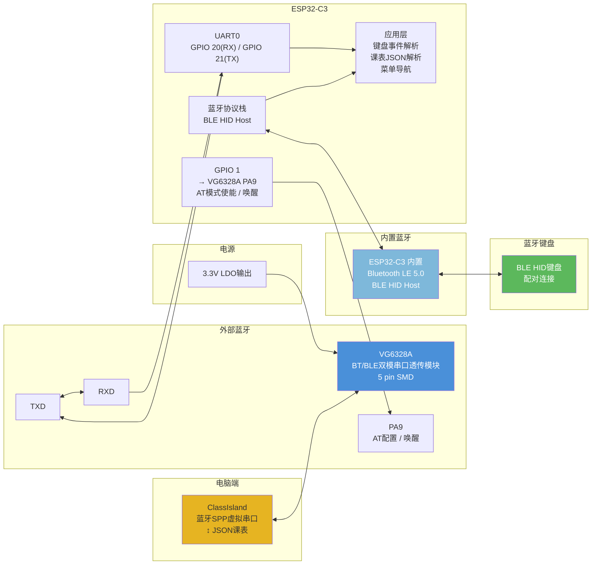

# 桌面墨水屏信息站 — 双蓝牙架构图



## 接线表

| VG6328A 引脚 | 名称 | 连接 | 备注 |
|:-----------:|:----:|------|------|
| 1 | RXD | ESP32 GPIO 21 (UART0 TX) | ESP32 发→模块收 |
| 2 | TXD | ESP32 GPIO 20 (UART0 RX) | 模块发→ESP32 收 |
| 3 | GND | GND | |
| 4 | VDD | 3.3V | 上电即工作，无 EN 脚 |
| 5 | PA9 | ESP32 GPIO 1 | 下降沿唤醒 + AT 模式 |

## 和 HC-05 的差异

| 项目 | HC-05 | VG6328A |
|------|-------|---------|
| 引脚数 | 6+ (VCC/GND/TXD/RXD/KEY/STATE/EN) | 5 (VDD/GND/TXD/RXD/PA9) |
| 封装 | 排针扩展板 (~28×13mm) | SMD 16×13.6mm |
| 协议 | 蓝牙 2.0 经典 + SPP | 蓝牙 5.3 **双模** (BT + BLE) |
| 价格 | ~¥10-15 | ¥3.89 |
| 波特率默认 | 38400 / 9600 | 115200 |
| EN 脚 | 有，需上拉 | 无，VDD 上电即工作 |
| STATE 脚 | 有 | 无，软件替代 |
| 源 | 淘宝/模块 | 立创商城 C20539408 |

## 通信流程

```
ClassIsland 发送课表 → VG6328A BT 接收 → UART → ESP32 解析JSON
                                                         → 存入 Flash (LittleFS)
                                                         → 更新墨水屏显示

蓝牙键盘连接 → ESP32 BLE HID Host → 按键事件
                                      → 菜单导航 / 番茄钟控制 / 切换显示内容
```

## 关键注意点

- 波特率默认 **115200**，需要和 ESP32 的 UART0 初始化保持一致
- AT 模式进入：GPIO 1 拉低（下降沿触发）→ 模块进入 AT 命令模式。发 `AT+NAMExxx` 改名称等
- 模块支持 BT/BLE 同时连接，ClassIsland 走 BT（经典蓝牙），键盘走 BLE，不再像 HC-05 需要两个蓝牙独立工作
- VDD 直连 3.3V，无需 EN 上拉电阻，模组自带 WROOM-02 的 EN 脚也不受影响
