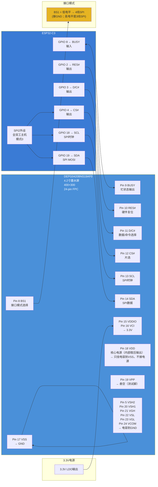

# 桌面墨水屏信息站 — 墨水屏 SPI 架构图



## 引脚连接汇总

| FPC Pin | 名称 | 类型 | 功能 | → ESP32 / 电源 |
|:-------:|:----:|:----:|------|---------------|
| 1 | NC | — | 悬空 | — |
| 2 | GDR | O | 栅极驱动控制 | **接外挂升压的 MOSFET 栅极** |
| 3 | RESE | I | 电流检测输入 | **经 2.2Ω 到 GND** |
| 4 | NC | — | 悬空 | — |
| 5 | VSH2 | C | 源驱动正压 | 1μF/25V → GND |
| 6 | TSCL | O | 温度传感器 I2C 时钟 | 悬空 |
| 7 | TSDA | I/O | 温度传感器 I2C 数据 | 悬空 |
| 8 | BS1 | I | 接口模式选择 | **接 GND**（低电平 = 4 线 SPI） |
| 9 | BUSY | O | 忙状态输出 | **GPIO 8**（输入） |
| 10 | RES# | I | 复位（低有效） | **GPIO 2**（输出） |
| 11 | D/C# | I | 数据/命令控制 | **GPIO 3**（输出） |
| 12 | CS# | I | 片选（低有效） | **GPIO 4**（输出） |
| 13 | SCL | I | SPI 时钟 | **GPIO 18**（SCK） |
| 14 | SDA | I/O | SPI 数据 | **GPIO 19**（MOSI） |
| 15 | VDDIO | P | 接口逻辑电源 | 3.3V（应与 VCI 同电位） |
| 16 | VCI | P | 芯片主电源 | 3.3V |
| 17 | VSS | P | 地 | GND |
| 18 | VDD | C | 核心逻辑电源（内部稳压输出） | **只挂 1μF/25V → GND，不接电源** |
| 19 | VPP | P | 测试脚 | 悬空 |
| 20 | VSH1 | C | 源驱动正压 | 1μF/25V → GND |
| 21 | VGH | C | 栅极驱动正压 | 1μF/25V → GND |
| 22 | VSL | C | 源驱动负压 | 1μF/25V → GND |
| 23 | VGL | C | 栅极驱动负压 | 1μF/25V → GND |
| 24 | VCOM | C | VCOM 驱动电压 | **0.47μF/25V → GND** |

## 电容清单

| FPC Pin | 信号 | 容值 | 耐压 | 接法（引脚→电容→GND，引脚不直接接地） |
|:-------:|:----:|:----:|:----:|------|
| 5 | VSH2 | 1μF | 25V | VSH2 ── 1μF ── GND |
| 18 | VDD | 1μF | 25V | VDD ── 1μF ── GND |
| 20 | VSH1 | 1μF | 25V | VSH1 ── 1μF ── GND |
| 21 | VGH | 1μF | 25V | VGH ── 1μF ── GND |
| 22 | VSL | 1μF | 25V | VSL ── 1μF ── GND |
| 23 | VGL | 1μF | 25V | VGL ── 1μF ── GND |
| 24 | VCOM | 0.47μF | 25V | VCOM ── 0.47μF ── GND |

## 驱动逻辑

```
初始化流程:
ESP32 拉低 RES# (FPC Pin 10) → 等待 ≥10ms → 拉高 RES# → 等待 ≥20ms
→ 检查 BUSY (FPC Pin 9) 是否空闲
→ 通过 SPI 发送初始化命令序列 (由驱动库完成)

刷图流程:
拉低 CS# (FPC Pin 12) → 通过 D/C# (FPC Pin 11) 区分 命令/数据 阶段
→ 发"写内存"命令 → 发图像数据 → 拉高 CS#
→ 发"刷新显示"命令
→ 轮询 BUSY (FPC Pin 9) = 低 → 刷新完成
→ ESP32 可进入深度休眠
```
