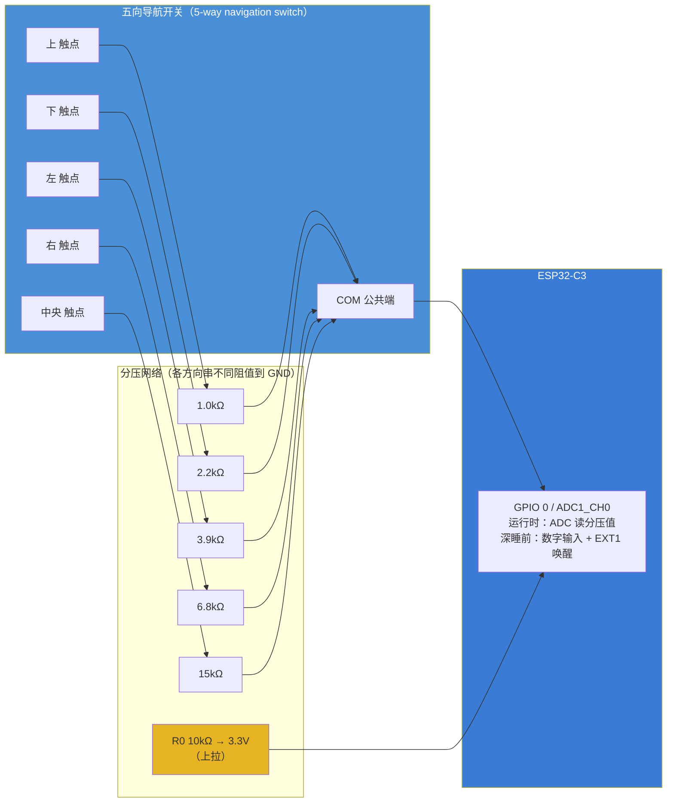

# 桌面墨水屏信息站 — 输入控制器（五向导航开关）架构图

> ⚠️ **器件已变更（2026-09-16）**
> 原方案 SIQ-02FVS3 编码器已弃用。它的滑动开关是单刀单掷（`S` 直通 `COM`）、物理上分不出方向（原厂 datasheet 已确认），而需求是「方向本身有意义」。
> 现方案为**五向导航开关（5-way navigation switch）**，本文描述新方案。选型过程记录见文末附录。



## 接线

| 开关引脚 | 名称 | 连接 |
|:--------:|:----:|------|
| COM | 公共端 | GPIO 0（分压中点） |
| 上 | 方向触点 | 1.0kΩ → GND |
| 下 | 方向触点 | 2.2kΩ → GND |
| 左 | 方向触点 | 3.9kΩ → GND |
| 右 | 方向触点 | 6.8kΩ → GND |
| 中央 | 中央触点 | 15kΩ → GND |
| — | 上拉 | 10kΩ → 3.3V（GPIO 0） |

**关键**：必须是「四个方向各自独立引出」的型号，避开矩阵式接法（矩阵式无法用单脚分压区分）。

## 电压判读表（R0 = 10kΩ）

| 动作 | 分压电阻 | GPIO0 电压（计算） |
|---|---|---|
| 上 | 1.0kΩ | ≈0.30 V |
| 下 | 2.2kΩ | ≈0.59 V |
| 左 | 3.9kΩ | ≈0.92 V |
| 右 | 6.8kΩ | ≈1.33 V |
| 中央 | 15kΩ | ≈1.98 V |
| 不拨 | ∞（仅上拉） | ≈3.3 V |

## 双身份：EXT1 唤醒 + ADC 读方向

同一个 GPIO 0 在深睡前后的两种用法：

```
深睡前：
  配成数字输入（上拉），任意方向按下都会把 GPIO0 拉低
  esp_deep_sleep_enable_ext1_wakeup(1 << 0, ESP_EXT1_WAKEUP_ANY_LOW)
  → 拨动即唤醒，静态零功耗

唤醒后：
  切换成 ADC1_CH0，读分压值 → 查表判方向 → 分发事件
  处理完 → 重新配回数字输入 → 再次深睡
```

## 注意事项

- GPIO 0 **不是** strapping 脚（C3 的是 GPIO2 / GPIO8 / GPIO9），可安全用作唤醒源
- C3 的 ADC 有非线性，各档间隔要大过校准误差；实测后微调分压电阻或加软件标定
- 消抖在软件里做（同一方向连续采样一致才确认）
- 若最终只用五向开关，原编码器占用的 **GPIO9 / GPIO10 可释放**

---

## 附录：原方案 SIQ-02FVS3（已弃用，仅存档）

| 编码器引脚 | 名称 | → ESP32 | 外围元件 |
|:---------:|:----:|---------|---------|
| C | COM | GND | 直连 |
| A | 编码器 A 相 | GPIO 9 | 10kΩ 上拉 → 3.3V + 0.1μF → GND |
| B | 编码器 B 相 | GPIO 10 | 10kΩ 上拉 → 3.3V + 0.1μF → GND |
| S | 滑动开关 | GPIO 0 | 10kΩ 上拉 → 3.3V |

弃用原因：`S` 与 `COM` 之间是单刀单掷，滑向左右都只是导通，软件无法区分方向。立创编号 R66 6557。
