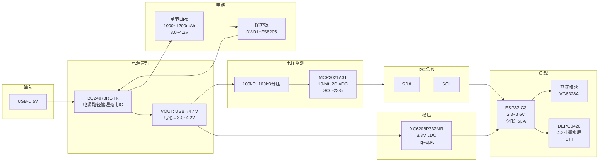

# 桌面墨水屏信息站 — 电源架构图

## BQ24073RGTR 引脚功能对照（'73 后缀）

> ⚠️ **关键提醒：CE(Pin 4) 必须接 GND（低电平使能）。不要接 OUT！**

| Pin # | 名称 | 类型 | 功能 | 我们的连接 | 正确性 |
|:-----:|:----:|:----:|------|-----------|:------:|
| 1 | TS | I | NTC 热敏电阻输入，无 NTC 时 10kΩ → VSS | 10kΩ → GND ✅ | ✅ |
| 2 | BAT | I/O | 电池连接正极 | 电池保护板 P+ | ✅ |
| 3 | BAT | I/O | 电池连接正极（内部并联） | 同 Pin 2 | ✅ |
| 4 | CE | I | 充电使能，低电平使能（高=禁能） | **GND**（始终使能） | ✅ |
| 5 | EN2 | I | 输入电流限制设置（与 EN1 配合） | GND | ✅ |
| 6 | EN1 | I | 输入电流限制设置（与 EN2 配合） | 直连 VOUT | ✅ |
| 7 | PGOOD | O | 电源就绪指示，低电平有效 | → ESP32 GPIO（可选） | ✅ |
| 8 | VSS | — | 地 | GND + 连接到热焊盘 | ✅ |
| 9 | CHG | O | 充电状态指示，低电平=充电中 | LED + 1kΩ → GND | ✅ |
| 10 | OUT | O | 系统输出电源 | XC6206 LDO VIN + 系统负载 | ✅ |
| 11 | OUT | O | 系统输出电源（内部并联） | 同 Pin 10 | ✅ |
| 12 | ILIM | I | 输入电流限制设置（EN2=1, EN1=0 时） | 10kΩ → GND（备用） | ✅ |
| 13 | IN | I | 电源输入（USB） | USB-C VBUS + 1μF+0.1μF → GND | ✅ |
| 14 | TMR | I | 充电安全定时器设置 | 36kΩ → GND（≈2h 定时） | ✅ |
| 15 | TD | I | 终止使能，接 VSS 启用终止 | GND | ✅ |
| 16 | ISET | I/O | 充电电流设置 | 2kΩ → GND (≈500mA) | ✅ |
| — | 热焊盘 | — | 必须连接到 VSS | GND | ✅ |

## ⚡ 关键连接一览

| 引脚 | 名称 | 必须接 | 绝对不能接 | 原因 |
|:---:|:----:|:------:|:---------:|------|
| 4 | CE | **GND** | OUT (4.4V) | 低电平=使能充电，高电平=禁能 |
| 5 | EN2 | GND | — | EN2=0, EN1=1 → USB500 模式 |
| 6 | EN1 | VOUT (3.3~4.4V) | GND | 见上 |
| 15 | TD | GND | VOUT | GND=启用终止 |
| 1 | TS | 10kΩ → GND | 悬空/浮空 | 无 NTC 时必须有电阻拉地 |

## EN1/EN2 设置表

| EN2 | EN1 | 最大输入电流 | 模式 |
|:---:|:---:|:-----------:|:----:|
| 0 | 0 | 100 mA | USB100 |
| **0** | **1** | **500 mA** | **USB500 ← 我们用这个** |
| 1 | 0 | 由 ILIM 电阻设定 | ILIM 模式 |
| 1 | 1 | 待机 | USB 暂停 |

**我们的设置：EN2=GND (0)，EN1=VOUT (1) → 输入限流 500 mA**

## BQ24073 外围元件表

| 位置 | 型号/值 | 封装 | 备注 |
|------|---------|------|------|
| IN 输入电容 | 1μF + 0.1μF | 0603 | 陶瓷 |
| OUT 输出电容 | 4.7μF | 0603 | 陶瓷 |
| BAT 电容 | 1μF | 0603 | 陶瓷 |
| ISET 电阻 | 2kΩ | 0603 | → GND，设定充电电流 500mA |
| TS 电阻 | 10kΩ | 0603 | → GND（无 NTC 时） |
| TMR 电阻 | 36kΩ | 0603 | → GND，设定定时器约 2h |
| TD 连接 | 直连 GND 或 0Ω | — | 启用充电终止 |
| CE 连接 | 直连 GND | — | 始终使能充电（低电平有效） |
| EN2 连接 | 直连 GND | — | EN2=0 |
| EN1 连接 | 直连 VOUT | — | EN1=1（CMOS 输入，无需限流） |
| ILIM 电阻 | 10kΩ → GND（备用） | 0603 | 当前 EN2=0 时不起作用 |
| /CHG LED 限流 | 1kΩ | 0603 | |
| 分压电阻 | 100kΩ + 100kΩ | 0603 | VOUT → 100k → MCP3021 VIN → 100k → GND |

## XC6206P332MR（SOT-23-3）

| Pin | 名称 | 功能 | 连接 | 正确性 |
|:---:|:----:|------|------|:------:|
| 1 | GND | 地 | GND | ✅ |
| 2 | VIN | 电源输入 | BQ24073 OUT (4.4V / 电池直通) | ✅ |
| 3 | VOUT | 稳压输出 3.3V | 全部系统供电 + I2C 上拉 + 五向开关上拉 | ✅ |

- 封装：SOT-23-3（三只脚，无 CE 使能脚，上电即工作）
- 输出电流：250mA（设备峰值不到 200mA，够用）
- 静态电流：6μA Typ（非之前写的 1μA）
- 输入电容：1μF → GND
- 输出电容：1μF → GND

## 总待机电流估算

| 器件 | 电流 | 备注 |
|------|:----:|------|
| ESP32-C3 深度休眠 | 5μA | |
| BQ24073 仅电池模式 | ~3μA | |
| XC6206 静态 | 6μA | |
| DS3231 | ~3μA | VBAT 模式 |
| MCP3021 关断 | ~1μA | |
| 合计 | **~18μA** | 日均耗电 ~25mAh → 1000mAh 电池续航约 **32 天** |

## MCP3021 接线

| 引脚  | 连接                        |
| --- | ------------------------- |
| VDD | 3.3V (LDO输出)              |
| VSS | GND                       |
| VIN | 分压中点                      |
| SCL | ESP32 GPIO + 4.7kΩ上拉至3.3V |
| SDA | ESP32 GPIO + 4.7kΩ上拉至3.3V |

注意：MCP3021A3T-E/OT 的 I2C 地址为 **0x4B**。地址由订购码后缀决定（A0T=0x48、A1T=0x49、A2T=0x4A、**A3T=0x4B**、A4T=0x4C、A5T=0x4D…），芯片本身只有 5 个引脚，没有外部地址引脚。
