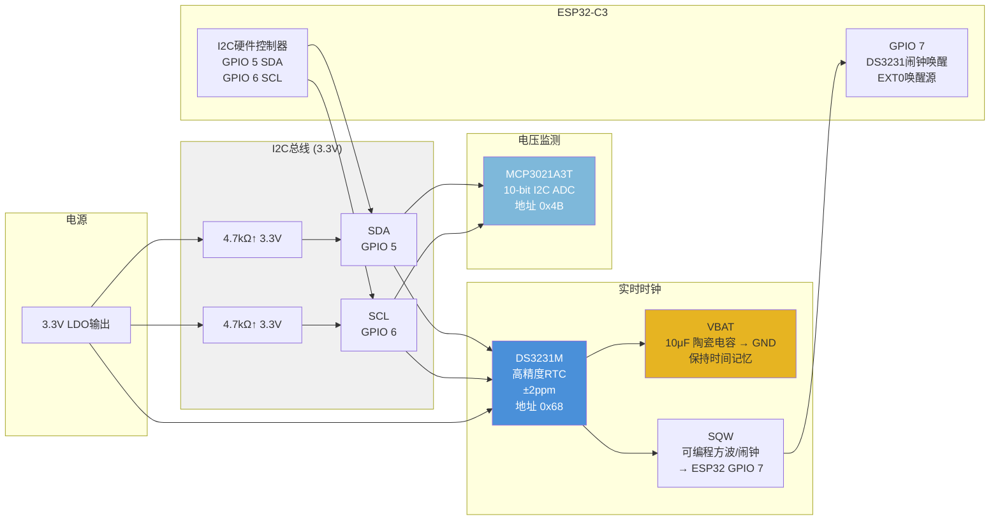

# 桌面墨水屏信息站 — I2C总线 & RTC 架构图



## I2C 总线设备总表

| 器件 | 地址 | 功能 | 占用引脚 |
|------|------|------|---------|
| MCP3021A3T | 0x4B | 电池电压监测 | SDA, SCL |
| DS3231M+ | 0x68 | 实时时钟 / 闹钟唤醒 | SDA, SCL, SQW→GPIO7 |

## DS3231 接线（DS3231M+，8-SO 封装）

| DS3231 引脚 | 连接 | 备注 |
|------------|------|------|
| 1 - 32KHZ | 悬空 | 32.768kHz 输出，不用 |
| 2 - VCC | 3.3V | 主供电 |
| 3 - INT/SQW | GPIO 7 | 闹钟唤醒输出，低电平有效 |
| 4 - RST | 悬空 | 低电平复位输出，由芯片内部驱动 |
| 5 - NC | 悬空 | |
| 6 - VBAT | 10μF → GND | 掉电短暂保持，无电池 |
| 7 - SDA | I2C SDA (GPIO 5) | 4.7kΩ 上拉到 3.3V |
| 8 - SCL | I2C SCL (GPIO 6) | 4.7kΩ 上拉到 3.3V |
| — Exposed Pad | ⚠️ GND | **底部焊盘必须接地，否则芯片不工作** |

## 唤醒策略

```
ESP32 深度休眠 (5μA)
        ↓
DS3231 独立走时 (SQW 高电平)
        ↓
闹钟时间到 → SQW 拉低 → GPIO 7 下降沿
        ↓
ESP32 被 EXT0 唤醒 → 20ms → I2C读时间 → 更新墨水屏 → 再次休眠
```

第一次上电或长时间断电后时间丢失，通过 ClassIsland 蓝牙同步恢复。
