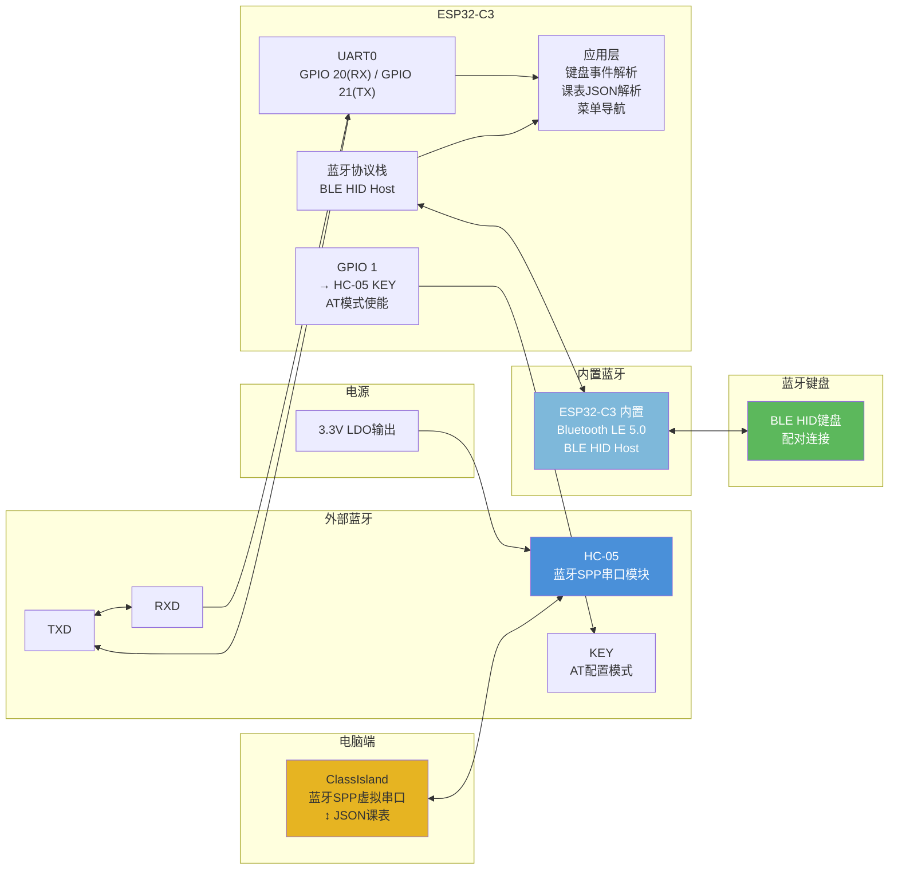

# 桌面墨水屏信息站 — 双蓝牙架构图



## 连线表

| HC-05 引脚 | 连接 | 备注 |
|-----------|------|------|
| VCC | 3.3V | 注意不要接5V |
| GND | GND | |
| TXD | ESP32 GPIO 20 (UART0 RX) | HC-05发→ESP32收 |
| RXD | ESP32 GPIO 21 (UART0 TX) | ESP32发→HC-05收 |
| KEY | ESP32 GPIO 1 | 高电平进入AT模式 |
| STATE | 悬空 | 软件替代检测 |
| EN | 3.3V (通过10kΩ上拉) | 使能引脚，保持高电平 |

## 通信流程

```
ClassIsland 发送课表 → HC-05 接收 → UART → ESP32 解析JSON
                                                            → 存入 Flash (LittleFS)
                                                            → 更新墨水屏显示

蓝牙键盘连接 → ESP32 BLE HID Host → 按键事件
                                      → 菜单导航 / 番茄钟控制 / 切换显示内容
```

## 关键注意点

- HC-05 默认波特率建议设为 **38400**（平衡速度与稳定性）
- AT 模式进入方式：GPIO 1 拉高 → HC-05 复位 → 进入 AT 命令模式。随时可改名称/波特率，无需开壳焊跳线
- 课表 JSON 格式参考 ClassIsland 文档，包长度控制在 HC-05 MTU（约 512 字节）内
- BLE 键盘配对建议用 **Just Works** 方式（无需输入PIN码），降低交互门槛
- HC-05 与 ESP32-C3 内置 BLE 同时工作无冲突——HC-05 用经典蓝牙，C3 用 BLE，互不干扰
