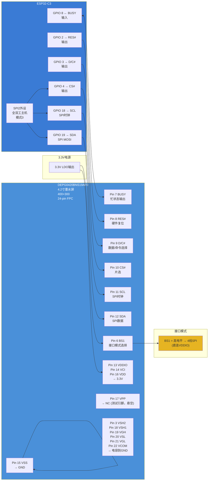

# 桌面墨水屏信息站 — 墨水屏 SPI 架构图



## 引脚连接汇总

| DEPG0420 引脚 | 功能 | 接 ESP32 | 备注 |
|--------------|------|---------|------|
| 6 - BS1 | 接口选择 | VDDIO (3.3V) | 高电平 = 4线SPI |
| 7 - BUSY | 忙状态 | GPIO 8 (输入) | 高=忙，低=空闲 |
| 8 - RES# | 硬件复位 | GPIO 2 (输出) | 低电平复位 |
| 9 - D/C# | 数据/命令 | GPIO 3 (输出) | 高=数据，低=命令 |
| 10 - CS# | 片选 | GPIO 4 (输出) | 低电平选中 |
| 11 - SCL | SPI时钟 | GPIO 18 (FSPI SCK) | |
| 12 - SDA | SPI数据 | GPIO 19 (FSPI MOSI) | |
| 13 - VDDIO | I/O电源 | 3.3V | |
| 14 - VCI | 主电源 | 3.3V | |
| 15 - VSS | 地 | GND | |
| 16 - VDD | 核心电源 | 3.3V | |
| 17 - VPP | OTP编程 | 悬空 | 测试引脚，不接 |

## 电源引脚（需外接电容）

| 引脚 | 功能 | 电容 |
|------|------|------|
| 3 - VSH2 | 源驱动负压 | 1μF/25V → GND |
| 18 - VSH1 | 源驱动正压 | 1μF/25V → GND |
| 19 - VGH | 栅极正压 | 1μF/25V → GND |
| 20 - VSL | 源驱动负压 | 1μF/25V → GND |
| 21 - VGL | 栅极负压 | 1μF/25V → GND |
| 22 - VCOM | VCOM驱动 | 0.47μF/25V → GND |

这些电容由屏内部 DC-DC 生成高压时使用，**必不可少**，每个引脚各一颗。

## 驱动逻辑

```
初始化流程:
ESP32 拉低 RES# → 等待 ≥10ms → 拉高 RES# → 等待 ≥20ms
→ 检查 BUSY 是否空闲
→ 通过 SPI 发送初始化命令序列 (由驱动库完成)

刷图流程:
拉低 CS# → 通过 D/C# 区分 命令/数据 阶段
→ 发"写内存"命令 → 发图像数据 → 拉高 CS#
→ 发"刷新显示"命令
→ 轮询 BUSY = 低 → 刷新完成
→ ESP32 可进入深度休眠
```
