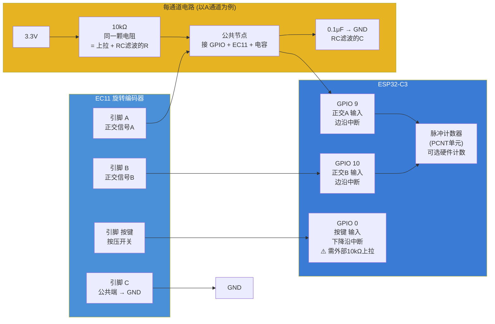

# 桌面墨水屏信息站 — 输入交互架构图



## 接线表

| EC11 引脚 | 信号 | 中间元件 | → ESP32 GPIO |
|-----------|------|---------|-------------|
| A | 正交A | 10kΩ 上拉到 3.3V + 0.1μF 到 GND | GPIO 9 |
| B | 正交B | 10kΩ 上拉到 3.3V + 0.1μF 到 GND | GPIO 10 |
| 按键一端 | 按压 | 10kΩ 上拉到 3.3V + 0.1μF 到 GND | GPIO 0 ⚠️ |
| 按键另一端 | GND | 直连 | GND |
| C (公共) | GND | 直连 | GND |

⚠️ GPIO 0 是 strapping 引脚，启动时拉低进入下载模式。**必须**加外部 10kΩ 上拉到 3.3V，确保常态高电平。

## 每个引脚的单通道完整电路

一颗电阻·两件事：

```
    3.3V
      │
    10kΩ  ←─ 这一颗就是全部：
      │       ① 把GPIO拉到3.3V（上拉）
      ├──────→ GPIO 9   ② 和电容组成低通滤波（消抖）
      │
     ╱
     ╲ EC11 引脚 A ── 旋转时触点到GND
     ╱
      │
    0.1μF ←── 电容对高频毛刺短路到GND
      │
     GND
```

三个通道（A、B、按键）各一套完全相同的电路，互不共用。

**编码器按键**：EC11 内置按键的一端接这个电路，另一端直接 GND。按压时 GPIO 读到低电平。

## 消抖原理

EC11 是机械触点，旋转时金属弹片会弹跳几十微秒到几毫秒，产生毛刺信号：

```
理想信号:  ████    ████    ████
实际信号:  ██▄▄████▄██▄██████▄▄████▄██▄██
```

RC 滤波器的作用：
- 10kΩ + 0.1μF → 时间常数 τ = 1ms
- 毛刺（μs 级）被电容吸收
- 稳定的电平变化（ms 级）正常通过

## 编码器读取逻辑

```
正转: A 先变低 → B 变低 → A 变高 → B 变高
反转: B 先变低 → A 变低 → B 变高 → A 变高

ESP32 PCNT 硬件自动计数 → 不用软件轮询
→ 旋转时触发中断 → 计数变化 → 更新菜单选项
→ 深度休眠时编码器中断可唤醒 CPU
```

## 按键功能设计

| 按键 | 功能 | GPIO | 备注 |
|------|------|------|------|
| 编码器按压 | 确认/进入 | GPIO 0 | 短按确认，长按回主页 |
