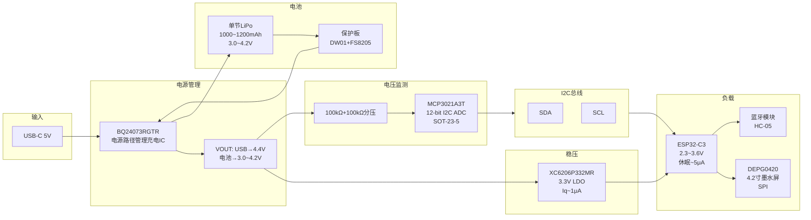

# 桌面墨水屏信息站 — 电源架构图

## 关键连接说明

| 信号 | 连接 | 备注 |
|------|------|------|
| USB-C VBUS | → BQ24073 IN (Pin 8) | 5V 输入 |
| BQ24073 OUT (Pin 16) | → LDO VIN | USB→4.4V / 电池→直通 |
| LDO VOUT (3.3V) | → ESP32 VDD | 系统主供电 |
| BQ24073 BAT (Pin 15) | → 电池保护板 P+ | 充电/放电共用 |
| VOUT 经分压 | → MCP3021 VIN | 100k + 100k → 1.5~2.2V |
| MCP3021 SDA/SCL | → ESP32 GPIO | I2C 总线 |
| BQ24073 /PG (Pin 13) | → ESP32 GPIO | 电源就绪指示 |
| BQ24073 /CHG (Pin 10) | → LED | 充电状态指示 |

## BQ24073 外围元件

| 位置 | 型号/值 | 封装 |
|------|---------|------|
| IN 输入电容 | 1μF + 0.1μF | 0603 |
| OUT 输出电容 | 2.2μF | 0603 |
| BAT 电容 | 1μF | 0603 |
| ISET 电阻 | 2kΩ (≈500mA 充电) | 0603 |
| TS 脚 | 10kΩ 上拉到 OUT（无NTC时） | 0603 |
| /CHG LED 限流 | 1kΩ | 0603 |
| 分压电阻 | 100kΩ + 100kΩ | 0603 |

## MCP3021 接线

| 引脚 | 连接 |
|------|------|
| VDD | 3.3V (LDO输出) |
| VSS | GND |
| VIN | 分压中点 |
| SCL | ESP32 GPIO + 4.7kΩ上拉至3.3V |
| SDA | ESP32 GPIO + 4.7kΩ上拉至3.3V |
| A0 | GND（地址 0x4D） |
| A1 | GND |
| A2 | GND |
